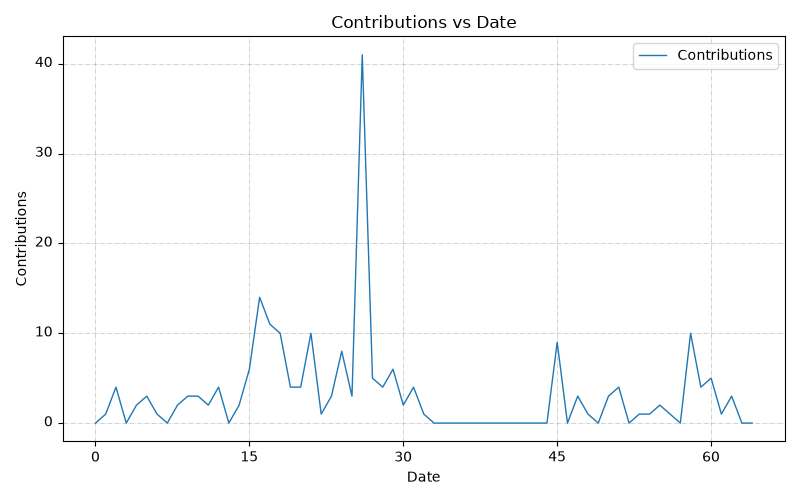

## Looking For Rust Engineering Roles

If you want me to be involved into your project, feel free to reach out via [e-mail](mailto:ales.tsurko@gmail.com).

Location: Poland - Remote, Hybrid; anywhere else - Remote. I can consider relocation within EU or North America if you provide visa sponsorship or legal support.

Preferable areas: audio, GUI applications, local-first applications, developer tools, backend.

## Stats

Updated daily.

***Languages By Contributions***

Io, C, Rust, JavaScript, Shell, Makefile, HTML, TypeScript, CSS, SuperCollider, Python, Objective-C, VimScript, Lua, Java, XML, WGSL, LilyPond, Just, GLSL, C++.

Number of contributions yesterday: **0**.

***Most Popular Repos***

- [cells](https://github.com/ales-tsurko/cells)
- [LearningCoreAudioWithSwift2.0](https://github.com/ales-tsurko/LearningCoreAudioWithSwift2.0)
- [microscale](https://github.com/ales-tsurko/microscale)
- [kotoist](https://github.com/ales-tsurko/kotoist)
- [eerie](https://github.com/IoLanguage/eerie)

***Recently Starred***

- [relax](https://github.com/makepad/relax)
- [xensieve-rs](https://github.com/ampullator/xensieve-rs)
- [rune](https://github.com/anomalyco/rune)
- [BUI](https://github.com/ppmpreetham/BUI)
- [chatterbox](https://github.com/resemble-ai/chatterbox)

